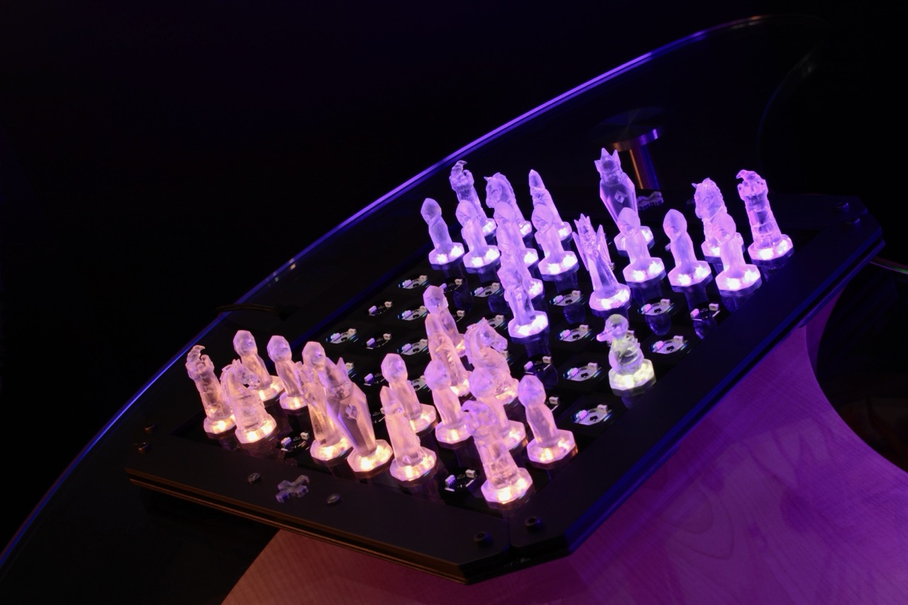

# Foxie Litch

Foxie Litch is an electronic chessboard. Move real pieces, follow the lights on the board, and use the iPhone, iPad or Android app to review games, change settings or paint your own light animations in Litchcraft. This repository contains the app, ESP32 firmware and V3.31 manufacturing files. The launch boards use the V3.3 electrical profile.

[Choose your Litch and trim finish at Foxie Products](https://foxieproducts.com/#buy). Explore [board and assembly photos](https://foxieproducts.com/#build), [Play and Game Review screenshots](https://foxieproducts.com/#features), and [Litchcraft on phones and tablets](https://foxieproducts.com/#litchcraft-screenshots).



Photo by Foxie Products, LLC. [Image credits and license](docs/images/README.md)

## Using your board

- For setup, moves, hints, undo and lighting, read the [Litch Manual on the Foxie Products website](https://foxieproducts.com/pages/manual). For the offline manual, tap the logo in the app header to open **About**, then choose **Litch Manual**. The [board controls guide](docs/controls_and_menu.md) also explains the buttons and light cues.
- Use **Play** for a game, **Litchcraft** to edit board artwork, and **Setup** to connect a board or change its settings. See the [companion app guide](app/README.md) and [mobile source downloads](docs/release/README.md#companion-app-source).
- For connection or update problems, use [Contact Support](SUPPORT.md). See [firmware downloads and corresponding source](docs/release/ci_foundation.md) for official update catalogs and relinking instructions.

## Classic CPU difficulty

The Litch 1.0 Classic CPU configuration was evaluated in 650 desktop games against Stockfish 17.1, using search budgets measured on an ESP32-S3 board. The ratings use Stockfish’s 1320 setting as their reference. The table rounds Elo estimates and intervals to the nearest ten.

| Level | Estimated Elo | Approx. 95% interval |
| ---: | ---: | ---: |
| 1 | Not estimated | Not estimated |
| 2 | 1,040 | 920–1,140 |
| 3 | 1,430 | 1,300–1,570 |
| 4 | 1,640 | 1,550–1,760 |
| 5 | 1,620 | 1,470–1,840 |
| 6 | 1,640 | 1,480–1,830 |
| 7 | 1,710 | 1,540–1,920 |
| 8 | 1,750 | 1,590–1,950 |
| 9 | 1,910 | 1,730–2,140 |
| 10 | 1,920 | 1,700–2,180 |
| 11 | 1,930 | 1,750–2,150 |

Each of levels 1–10 played 50 games. Level 11 played 150. Litch played 25 six-ply openings once with each color at all eleven levels, then played 50 more openings with both colors at Level 11.

Level 1 lost all 50 games against Stockfish’s 1320 setting, leaving its rating unestimated. Level 11 scored 81 wins, 13 draws and 56 losses for an estimate of **1,928 Elo** (95% interval **1,753–2,153**).

Level 11 has a 60-second search limit and can prepare a reply during the human turn after Hint finishes. The matches measured ordinary move search. [Detailed scores and method](https://github.com/foxieproducts/litch-max#classic-playing-strength) · [Search speed on the board](https://github.com/foxieproducts/litch-max#search-on-the-esp32-s3) · [Opening scores and board measurements](tools/elo/classic_strength_1_0.json)

## Building or repairing Litch

| What you need | Where to find it |
| --- | --- |
| V3.31 schematic, editable PCB, Gerbers, BOM and placement data | [PCB files](pcb/README.md) |
| Board layers, trim, buttons, chess pieces and assembly materials | [Manufacturing files](manufacturing_models/README.md) · [V3.31 Production in Onshape](https://cad.onshape.com/documents/36b6c3345bd9da34237c9cc5/v/28bed04f3bcabb4786b0f935/e/386ee92bbe14e6422dd1ab4a) |
| Pins, controls, LEDs, sensors and power | [Hardware maps](docs/hardware/hardware_overview.md) |
| Follow an opening move through firmware and the app | [From the Hall sensor on e2 to Play](docs/e2e4.md) |
| BLE pairing, updates and app-to-board messages | [Technical reference](docs/spec/README.md) |
| Classic and Duck chess rules, search and opening book | [Litch-Max source and safe build instructions](CONTRIBUTING.md#building-the-included-engine) |

To build locally, use macOS or native Linux with Git, Python 3.9 or newer with `venv` and `pip`, and a host C++17 compiler available as `c++`. Clone the repository with its pinned Litch-Max engine submodule:

```sh
git clone --recurse-submodules https://github.com/foxieproducts/litch.git
cd litch
```

For an existing Git checkout, run `git submodule update --init --recursive` from the repository root after checking out the revision you want to build. GitHub's automatic source ZIP does not include submodule contents; use the [corresponding source bundle](docs/release/ci_foundation.md#rebuild-relink-and-install) to rebuild shipped firmware.

From the repository root, create the Python environment, install the pinned tools and fetch the firmware dependencies:

```sh
python3 -m venv .venv
. .venv/bin/activate
python -m pip install platformio==6.1.19 esptool==4.9.0
./litch bootstrap firmware
./litch doctor --scope firmware
./litch build s3
```

Keep the environment active for later `./litch` commands. On Linux, install your distribution's Python venv package if it is missing. The build checks the launch firmware and compiles a host fixture; it does not require a board. For a board-free test and the included engine build, see [Contributing](CONTRIBUTING.md).

For USB installation and recovery, see the [firmware guide](docs/release/ci_foundation.md). For Flutter prerequisites and platform builds, see the [app guide](app/README.md).

## Licenses

Foxie Products, LLC licenses its original software under [MPL 2.0](LICENSE), its functional hardware designs under [CERN-OHL-S-2.0](LICENSE-HARDWARE), and its original documentation and listed photographs under [CC BY-SA 4.0](LICENSE-DOCUMENTATION). These licenses allow commercial use under their respective terms. Foxie reserves its trademarks. Third-party software and artwork carry their own terms.

[Documentation](docs/README.md) · [Third-party notices](THIRD_PARTY_NOTICES.md) · [Release information](docs/release/README.md) · [Acknowledgements](ACKNOWLEDGEMENTS.md) · [Contributing](CONTRIBUTING.md) · [Security](SECURITY.md)
