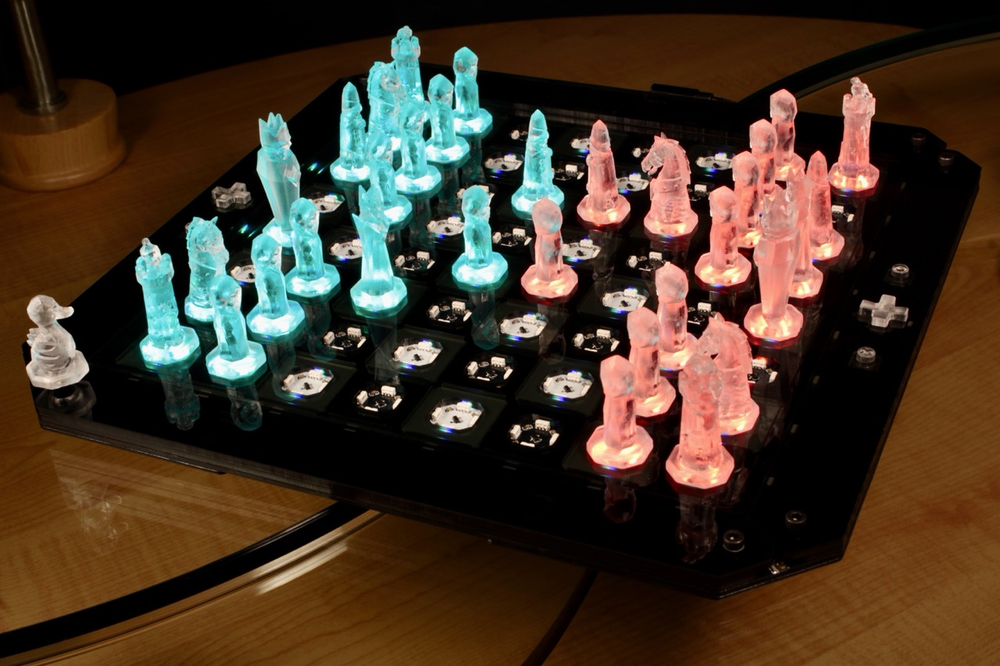
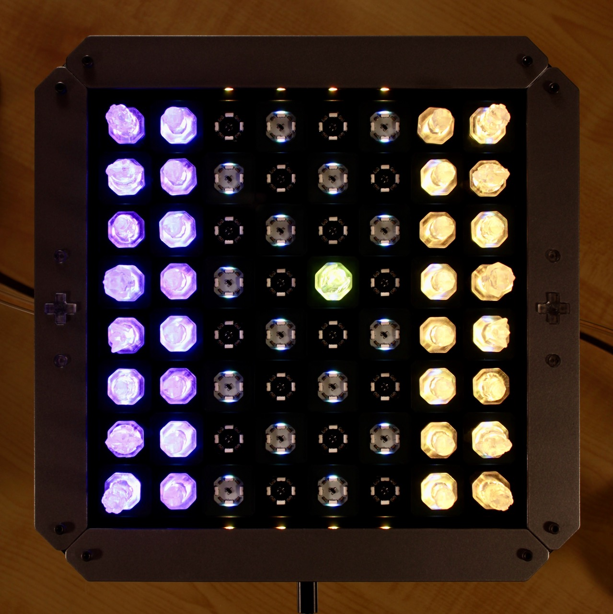
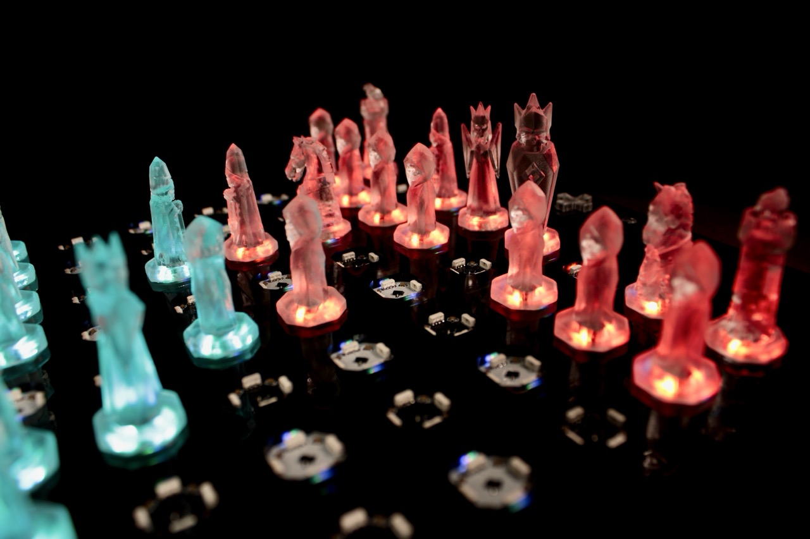
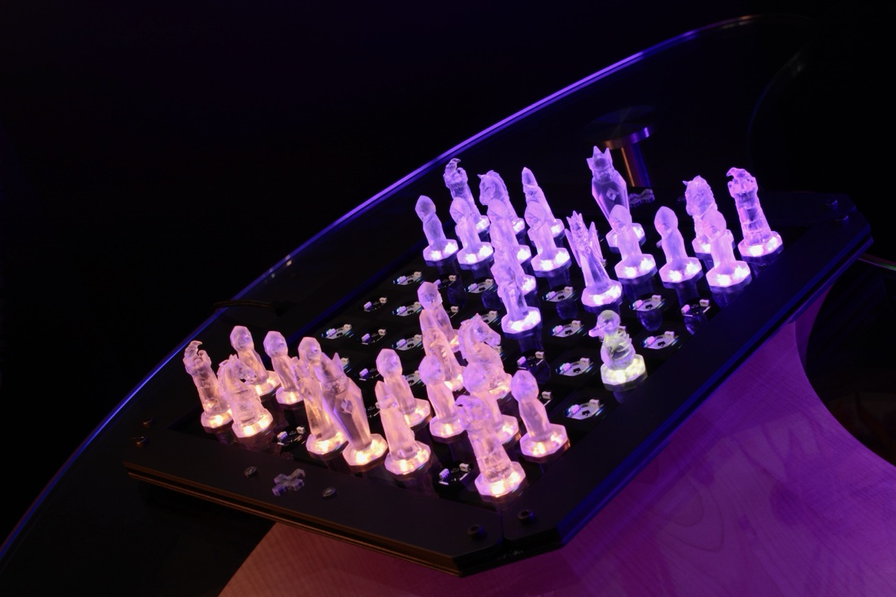

# Litch V3.31 photographs and documentation images

Selected product photographs and PCB design previews used in the
[main README](../../README.md), [PCB guide](../../pcb/README.md), and
[mechanical guide](../../manufacturing_models/README.md). The About screen also
uses the Foxie Planet photograph as its identity-card background.

## License and attribution

The 14 images listed below and the copy of Foxie Planet included in the app
are copyright Foxie Products, LLC and licensed under
[Creative Commons Attribution-ShareAlike 4.0 International
(CC BY-SA 4.0)](https://creativecommons.org/licenses/by-sa/4.0/). The canonical
grant and legal text are in [LICENSE-DOCUMENTATION](../../LICENSE-DOCUMENTATION),
also referenced by this directory's [LICENSE](LICENSE).

Credit **Foxie Products, LLC**, link to the source image and license, and identify
changes when sharing. Shared adaptations retain the applicable share-alike
terms. The About screen uses the same licensed Foxie Planet photo, cropped to
fill the card and dimmed for text legibility.

The image grant does not grant trademark rights or separately license branding
artwork. The underlying functional hardware designs remain under
[CERN-OHL-S-2.0](../../LICENSE-HARDWARE). Images elsewhere in the repository are
not covered by this list.

| File | Description |
| --- | --- |
| [hero_bronze_orange_purple.jpeg](litch-v3.31/hero_bronze_orange_purple.jpeg) | Product photograph: bronze-finish trim, orange and purple illumination. |
| [gameplay.jpeg](litch-v3.31/gameplay.jpeg) | Product photograph: a game position with cyan and red illumination. |
| [overhead.jpeg](litch-v3.31/overhead.jpeg) | Overhead photograph of the assembled board and pieces. |
| [close_up.jpeg](litch-v3.31/close_up.jpeg) | Close-up photograph of the translucent chess pieces. |
| [foxie_planet.jpeg](litch-v3.31/foxie_planet.jpeg) | Angled photograph of the board under purple lighting, featured on the project home page. |
| [app/assets/images/foxie_planet.jpeg](../../app/assets/images/foxie_planet.jpeg) | App copy of [foxie_planet.jpeg](litch-v3.31/foxie_planet.jpeg), credited to Foxie Products, LLC under the same CC BY-SA 4.0 grant. |
| [side.jpeg](litch-v3.31/side.jpeg) | Side photograph of the assembled board and pieces. |
| [top_parts_view.jpeg](litch-v3.31/top_parts_view.jpeg) | Photograph of the PCB, board layers and assembly parts. |
| [vex.jpeg](litch-v3.31/vex.jpeg) | Close-up photograph of the illuminated duck-shaped Vex piece. |
| [trim_acrylic.jpeg](litch-v3.31/trim_acrylic.jpeg) | Photograph of the acrylic trim. |
| [trim_bronze_metal.jpeg](litch-v3.31/trim_bronze_metal.jpeg) | Photograph of the bronze-finish metal trim. |
| [trim_matte_black_metal.jpeg](litch-v3.31/trim_matte_black_metal.jpeg) | Photograph of the matte-black metal trim. |
| [trim_metallic_gray_metal.jpeg](litch-v3.31/trim_metallic_gray_metal.jpeg) | Photograph of the metallic-gray metal trim. |
| [pcb_front_preview.png](litch-v3.31/pcb_front_preview.png) | PCB front design preview, not a photograph. |
| [pcb_back_preview.png](litch-v3.31/pcb_back_preview.png) | PCB back design preview, not a photograph. |

## Photo gallery

| Game position | Overhead view |
| --- | --- |
|  |  |
| **Piece detail** | **Angled view** |
|  |  |

See the [PCB guide](../../pcb/README.md#board-views) for front/back previews and
assembly parts, and the [mechanical guide](../../manufacturing_models/README.md#trim-finishes)
for the trim comparison. All gallery photographs: Foxie Products, LLC ·
[CC BY-SA 4.0](https://creativecommons.org/licenses/by-sa/4.0/).
