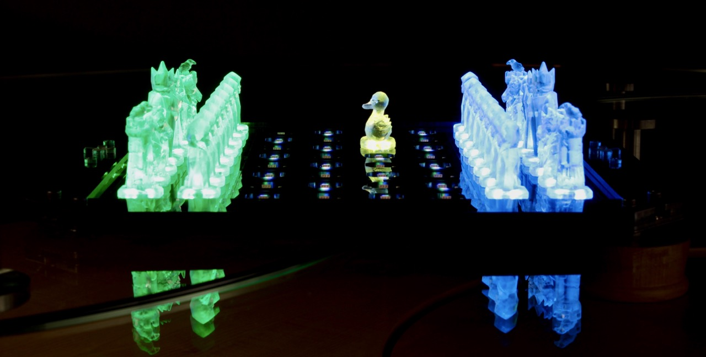
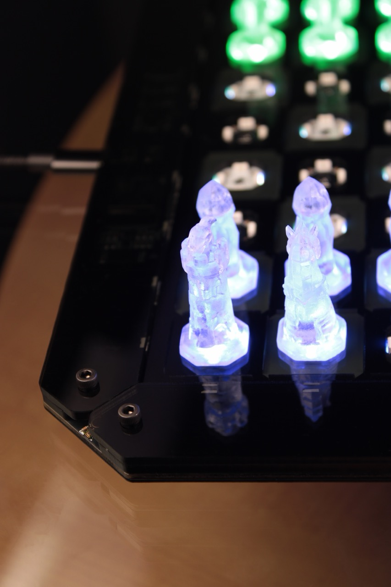
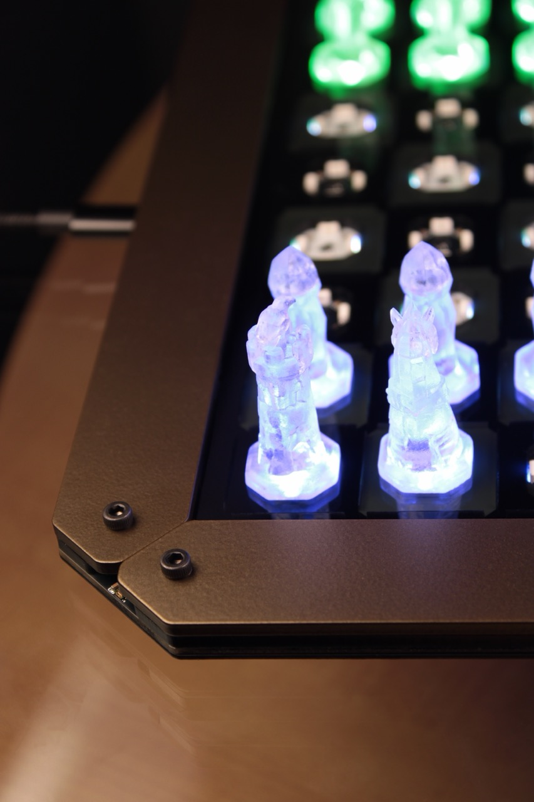
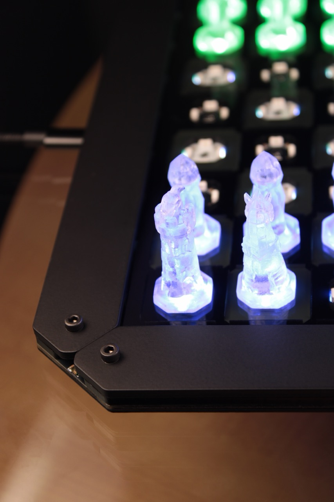
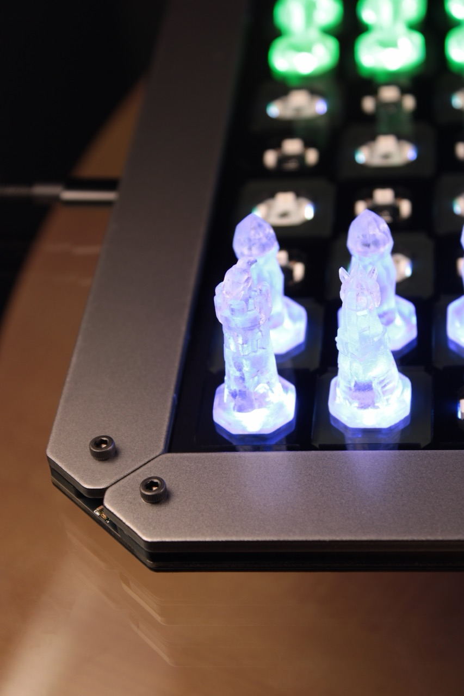

# Litch V3.31 mechanical designs

Copyright (c) Foxie Products, LLC. The original functional mechanical designs
and the exports listed here use [CERN-OHL-S-2.0](../LICENSE-HARDWARE). Section 6
of the licence describes the warranty disclaimer and liability limits.

The [Litch repository](https://github.com/foxieproducts/litch) is the Source
Location. For the editable parts and assembly, open [V3.31 Production in Onshape](https://cad.onshape.com/documents/36b6c3345bd9da34237c9cc5/v/28bed04f3bcabb4786b0f935/e/386ee92bbe14e6422dd1ab4a). This fixed version contains the native models for the files below.

| Export | Contents |
| --- | --- |
| DXF | [Acrylic top](<V3.31/V3.31 - Acrylic Top - MANUF.dxf>), [steel sheet](<V3.31/V3.31 - Steel Sheet - MANUF.dxf>), [LR trim](<V3.31/V3.31 - LR Trim - MANUF.dxf>) and [TB trim](<V3.31/V3.31 - TB Trim - MANUF.dxf>) |
| STL | [Chess pieces](<V3.31/V3.31 - Chess Pieces - CLR_0.075mm/>) and [D-pad, X and O buttons](<V3.31/V3.31 - D-Pad, X + O/>) |

The DXF and STL files provide manufacturing geometry. Use the corresponding
native Onshape model for parametric changes. See [PCB design and fabrication
files](../pcb/README.md) for the electronic assembly.

## Assembled board and pieces

| Side view | Vex piece detail |
| --- | --- |
|  |  |

## Trim finishes

| Acrylic | Bronze-finish metal |
| --- | --- |
|  |  |
| **Matte-black metal** | **Metallic-gray metal** |
|  |  |

These photographs compare appearance; the metal finish names do not specify
the underlying alloy. Photos: Foxie Products, LLC ·
[CC BY-SA 4.0](../LICENSE-DOCUMENTATION); [image credits](../docs/images/README.md).

## Assembly materials

Use these dimensions when sourcing assembly parts.

| Item | Specification |
| --- | --- |
| Acrylic stock | Nominal **3 mm** for the acrylic parts, currently a design assumption rather than a measured stock tolerance. |
| Steel sheet | **1.2 mm**, powder coated. Steel grade still needs fabricator confirmation. |
| Piece magnets | **N52**, round, **1/4 inch diameter × 1/8 inch thick** (6.35 × 3.175 mm). |
| Bolts | **8 × M3 × 10 mm**. |
| Self-clinching nuts | Proposed: **8 × PEM S-M3-1ZI, M3 × 0.5**; the installed part has not been verified. |
| Rubber feet | **4**, for the **11 mm** holes in the DXF. Choose a stem and retainer that fit the finished hole. |

DXF units are millimetres. Treat the STL dimensions as millimetres; STL itself
does not embed a unit declaration. Preserve the intended operation for the
acrylic `CENTER CUT H` and `CENTER CUT V` layers instead of treating every open
segment as an outline cut. Metal trim thickness is not specified here, and the
completed stack has not been checked for the specified 10 mm bolt length.

The eight steel nut holes are nominally **4.267 mm** in the DXF. This falls
within the proposed [PEM S-M3-1ZI](https://catalog.pemnet.com/item/nuts-types-s-ss-cls-clss-sp-metric/s-m3-1zi)
hole range of **4.22–4.30 mm**, and the specified 1.2 mm sheet exceeds its
**1.0 mm** minimum. The selection remains conditional on ductile steel no harder
than **HRB 80 / HB 150**, suitable hole preparation and fabricator confirmation.
Install the nuts before powder coating, mask the threads and inspect them after
coating; see [PEM's surface finish guidance](https://www.pemnet.com/wp-content/uploads/sites/2/2022/06/Surface_Finish.pdf).

All seven piece STL magnet pockets are nominally **6.50 mm** in diameter and
approximately **3.45 mm** deep. Against a 6.35 × 3.175 mm magnet, that gives
approximately **0.075 mm radial clearance**. These nominal dimensions do not
establish printed fit or magnet retention.

The board, acrylic top and steel sheet share a 260.8 × 260.8 mm outline,
25 mm square pitch, eight common mounting centers and matching control
positions. Two additional diagonal PCB holes have no matching holes in the acrylic or steel.

## Section through a mounting screw

Read the section from the visible screw head toward the bottom cover at one
of the eight shared mounting centers. The trim and the acrylic top cover
different areas of the board. Use the outlines at the selected center to see
which layers the screw passes through.
[Parts laid out before assembly](../docs/images/litch-v3.31/top_parts_view.jpeg) · [Production assembly](https://cad.onshape.com/documents/36b6c3345bd9da34237c9cc5/v/28bed04f3bcabb4786b0f935/e/386ee92bbe14e6422dd1ab4a)

| Along the screw axis | Nominal design evidence |
| --- | --- |
| Screw head and top trim | M3 × 10 mm screw. Acrylic stock is nominally 3 mm. Measure the metal finish selected for the build. |
| Top and electronics | Locate the mounting hole and the acrylic cutout in the [top drawing](<V3.31/V3.31 - Acrylic Top - MANUF.dxf>). The [PCB design](../pcb/Litch_v3.31_PROD_ProDoc_2026-10-22.epro2) models a two-layer FR4 board about 1.60 mm thick, including the two copper and solder-mask layers. |
| Bottom cover and nut | 1.2 mm steel before powder coating. The [steel drawing](<V3.31/V3.31 - Steel Sheet - MANUF.dxf>) gives a 4.267 mm nut hole. The proposed nut has an M3 × 0.5 thread. |

To check the 10 mm bolt, measure from its seating face to the first full nut
thread on an assembled corner. Record the trim thickness and the face of the
steel carrying the nut head. Seat the bolt, measure the engaged thread length
and check clearance at the tip. Repeat for each trim material. The flat
drawings alone cannot establish the finished grip length.
