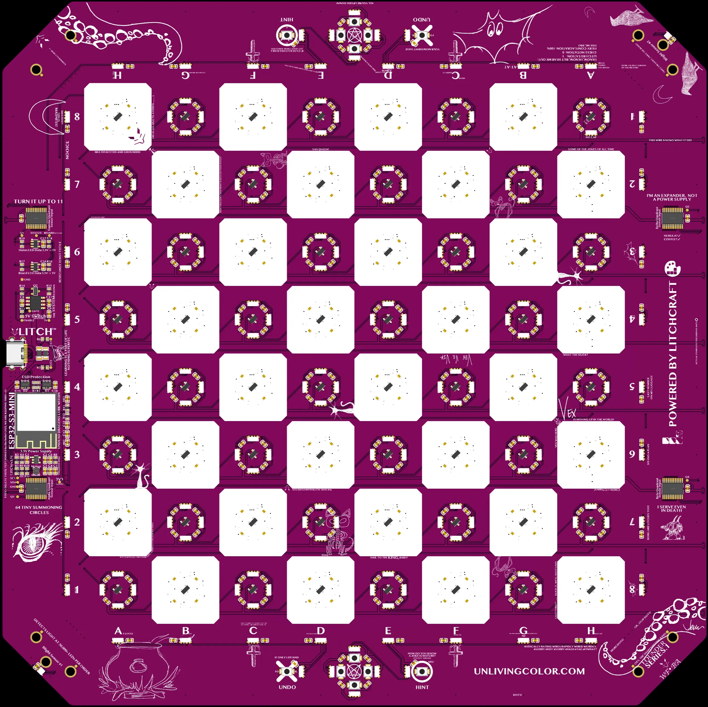
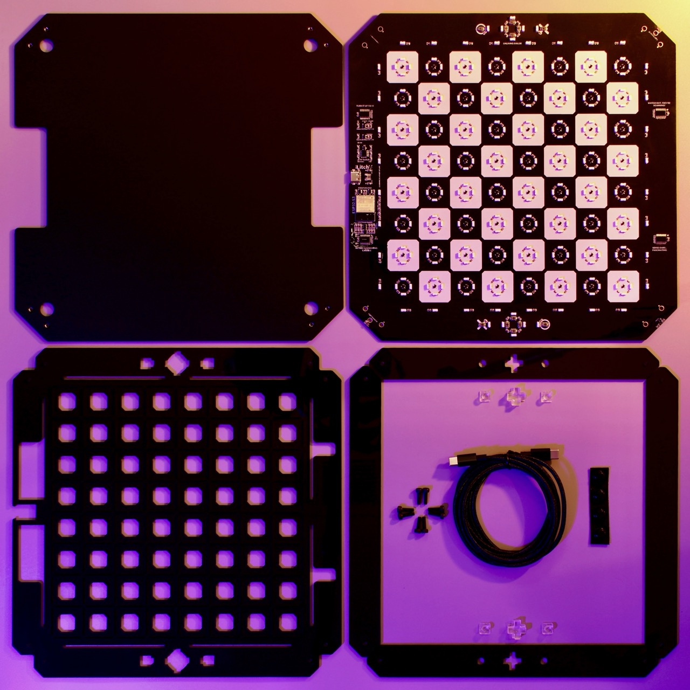

# Litch V3.31 PCB

Copyright (c) Foxie Products, LLC. The original PCB design and its exports
listed here use [CERN-OHL-S-2.0](../LICENSE-HARDWARE). Section 6 of the licence
describes the warranty disclaimer and liability limits.

The [Litch repository](https://github.com/foxieproducts/litch) is the Source
Location. The [EasyEDA Pro project on OSHWLab](https://oshwlab.com/foxieproducts/litch)
is the hosted design.

| File | Use |
| --- | --- |
| [EasyEDA Pro project](Litch_v3.31_PROD_ProDoc_2026-10-22.epro2) | Editable V3.31 schematic and layout. Import the project archive in EasyEDA Pro. |
| [Schematic PDF](Litch_v3.31_Schematic_2026-10-22.pdf) | Read the schematic without EasyEDA Pro. |
| [PCB PDF](Litch_v3.31_PCB_2026-10-22.pdf) | Inspect the board layout without EasyEDA Pro. |
| [Gerber and drill files](Gerber_PCB_v3.31_2026-10-20.zip) | Fabricate the bare PCB. |
| [Bill of materials](BOM_v3.31_PROD_PCB_v3.31_2026-10-20.xlsx) | Source components using the reference designators, quantities and manufacturer or supplier part numbers. |
| [Pick-and-place spreadsheet](PickAndPlace_PCB_v3_31_2026_10_20.xlsx) | Locate and orient components for assembly. |

Use the EasyEDA Pro archive when editing the design. The PDFs and Gerbers give
readable views and manufacturing data. Supplier components and documentation
carry their own terms. See [mechanical models](../manufacturing_models/README.md)
for the matching V3.31 manufacturing exports.

## Board views

| Front design preview | Back design preview |
| --- | --- |
|  |  |

These are design previews. Use the native project and fabrication files above
for manufacturing dimensions and component placement.

The physical PCB and surrounding assembly parts. Images: Foxie Products, LLC ·
[CC BY-SA 4.0](../LICENSE-DOCUMENTATION); [image credits](../docs/images/README.md).
The underlying functional hardware designs remain under CERN-OHL-S-2.0.

## Assembly notes

The V3.31 production drawing selects firmware's V3.3 profile: R3 and R4 are
fitted and R5 is not, giving raw board revision 3. R5 and R20 appear in placement
data but are intentionally excluded from the BOM; preserve those do-not-fit
choices for assembly.

U3's selected orderable is **TPAP2112K-3.3TRG1, C3021085**, matching the native
override, schematic and BOM. The placement file's Device field retains an older
AP2112K library title; its Comment and Name fields identify the TPAP part, and
the BOM gives C3021085. Use the selected orderable, not that legacy library title.
